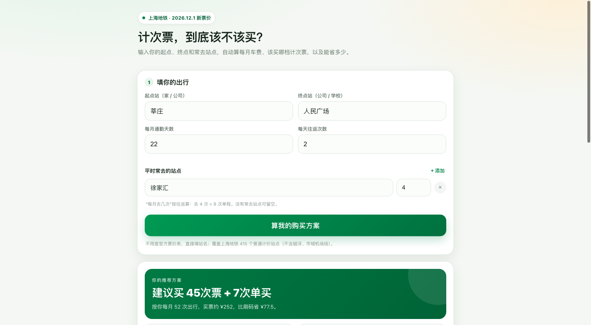

# 上海地铁计次票计算器

输入起点、终点和平时常去的站点，估算在上海地铁 2026 年 12 月 1 日新票价机制下，**该不该买计次票、买哪一档、每月能省多少**。

**在线使用：** https://borissun0424-boop.github.io/shanghai-metro-ticket-calculator/



## 功能

- 输入起点站、终点站，以及最多 5 个常去站点
- 支持常用叫法：上海站、虹桥站、浦东机场、国展中心、黄陂南路等
- 自动计算每段行程的最短路径、公里数、新票价和涨价前票价
- 对比 35 / 45 / 60 / 90 次四档计次票
- 计算“不买票、满 90 元打 9 折”的每月支出
- 给出推荐方案：买哪档、是否组合单买、每月省多少
- 短途会明确提示“不买计次票更划算”

## 怎么用

1. 起点填家或公司附近的站，终点填公司或学校附近的站。
2. 每月通勤天数默认 22 天，每天往返次数默认 2 次。
3. “平时常去的站点”填 0–5 个，右侧填每月往返次数。
4. 点“算我的购买方案”。
5. 看三块结果：推荐方案、你的行程、四档计次票对比。

## 计算口径

- 票价按上海地铁 2026 年 12 月 1 日起执行的新机制：3 元起乘，起乘间距 0–4 公里；后续按 4、4、4、7、7、10、10 公里加价；50 公里以上每 15 公里加 1 元，封顶 15 元。
- 计次票：35 次 190 元、45 次 210 元、60 次 270 元、90 次 390 元。
- 同一支付渠道自然月累计满 90 元后，后续票价 9 折。
- 计次票不与满额优惠、公交换乘优惠同享。
- 计次票激活后 30 个自然日有效、实名、不可转让；本工具假设一个月内能用完。
- 只计算普通地铁线路，不含磁浮线、市域机场线等单独计价线路。
- 换乘不额外计里程，但会给换乘加一点路径权重，优先选择少换乘的路线。

## 数据与算法

- 覆盖 415 个普通计价站点、496 段区间。
- 站点坐标与线路顺序来自开源项目 [madneal/subway-shanghai](https://github.com/madneal/subway-shanghai)（MIT License）。
- 站间距离按经纬度球面距离计算，并乘以 1.12 的轨道绕行修正。
- 使用 Dijkstra 算法计算最短路径，同时对换乘增加 2.0 公里的等效权重，避免“距离更短但多换两次”的路线。
- 同名换乘站合并；国家会展中心 2 号线与 17 号线之间补了同站换乘边。
- 票价档位已用官方示例校验，例如：
  - 人民广场 → 陆家嘴约 3.1 公里，3 元
  - 虹桥火车站 → 南京东路约 19.6 公里，7 元
  - 上海火车站 → 上海南站约 15.0 公里，6 元（涨价前 4 元）
  - 西岑 → 滴水湖约 130.4 公里，15 元

## 本地运行

这是一个单文件 HTML，不依赖服务器或第三方库：

```bash
open index.html
```

也可以把 `index.html` 放到任意静态网站托管服务。

## 免责声明

本项目是个人制作的**估算工具**，不是上海地铁官方产品。实际票价、里程、换乘方案和计次票规则以上海地铁官方查询、车站公告及闸机扣费为准。

## 官方参考

- 上海地铁新闻中心：https://www.shmetro.com/p1/xwzx.html
- 上观新闻（新票价与计次票规则）：https://www.jfdaily.com/news/detail?id=1218787
- 上海交通（新票价查询入口）：http://news.qq.com/rain/a/20261123A0BVAH00

## License

代码以 MIT License 发布。第三方数据来源与许可证见 [THIRD_PARTY_NOTICES.md](THIRD_PARTY_NOTICES.md)。
